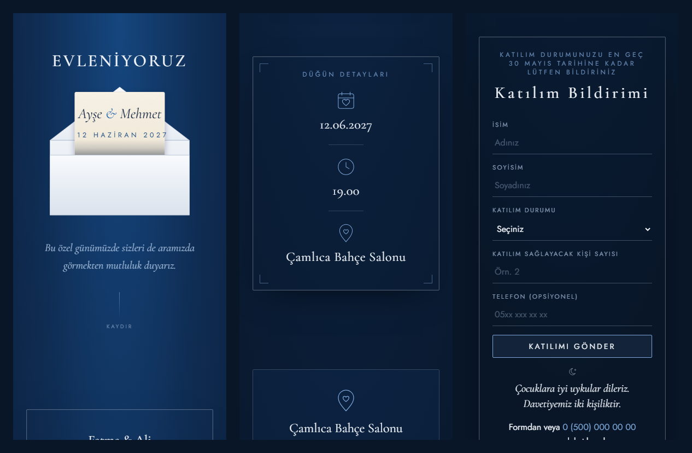
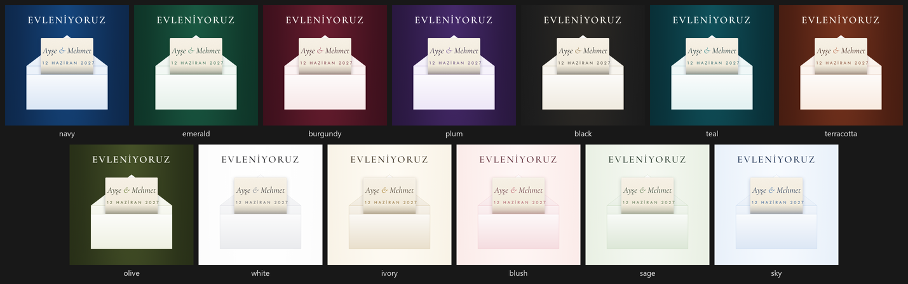

# 💌 Wedding Invitation · Düğün Davetiyesi

[🇹🇷 Türkçe](README.md) · **🇬🇧 English**

A scrollable, mobile-friendly, single-page wedding invitation. Guests RSVP through a form and the
answers land in **your own Google Sheet**.

**No coding required.** Every setting lives in one file: [`invitation.yaml`](invitation.yaml).
You set it up entirely in the browser, with nothing to install, and host it **for free**.



**Sections:** envelope with names and date → families and a countdown → schedule →
date, time and venue with a map → RSVP form → photo sharing link and a thank-you note.
Turkish and English are built in, and you can choose from **13 color themes** (8 dark, 5 light).

---

## 🚀 Setup (about 10 minutes)

All you need is a free [GitHub](https://github.com/signup) account.

### 1. Copy the template
Click the green **Use this template → Create a new repository** button at the top of this page.
Give it a name (e.g. `our-wedding`), choose **Public** and click **Create repository**.

### 2. Turn on publishing
In your new repository, go to **Settings → Pages** and set **Source** to **GitHub Actions**.

### 3. Fill in your details
Open `invitation.yaml` in your repository and click the **✏️ (pencil)** icon at the top right.
Set `language: en`, then change the names, date, families, venue and links. Click **Commit changes…** when you're done.

> 💡 Only change the part **after** the `:`. Leave the names on the left and the leading spaces
> as they are. Every field has a short explanation above it.

### 4. Your invitation is live 🎉
Within 1–2 minutes the run in the **Actions** tab turns green ✅. Your link is:

```
https://<your-github-username>.github.io/<repository-name>/
```

(You can also find it under **Settings → Pages**.) From then on, every change you make to
`invitation.yaml` goes live automatically within a few minutes.

> If the first run started before step 2, it may show a red ❌. Open **Actions** → the latest run →
> **Re-run all jobs**.

---

## 📝 RSVP form (Google Sheets)

Do this one-time setup so the form can save answers. While `rsvp.scriptUrl` is empty, the form runs
in **demo mode**: guests see the "Thank you" screen, but their answers are **not saved**.

1. Create a new Google Sheet at [sheets.new](https://sheets.new) (e.g. "Wedding RSVP").
2. Open **Extensions → Apps Script**.
3. Delete everything in the editor and paste in the contents of [`apps-script/Code.gs`](apps-script/Code.gs).
   Click 💾 **Save**.
4. Click **Deploy → New deployment** at the top right. Pick **Web app** under ⚙️, then set:
   - **Execute as:** *Me*
   - **Who has access:** *Anyone*

   and click **Deploy**.
5. When Google asks for permission, choose your account. If you see *"Google hasn't verified this app"*,
   click **Advanced → Go to (project name) (unsafe)** and then **Allow**. You see this warning because
   you created the script yourself, and that's expected. The script only adds rows to this sheet.
6. Copy the **Web app URL** (`https://script.google.com/macros/s/…/exec`) and paste it into
   `invitation.yaml` under `rsvp`:
   ```yaml
   rsvp:
     scriptUrl: "https://script.google.com/macros/s/AKfy.../exec"
   ```
7. Send a test RSVP from your invitation. A new row, with a header row above it, should appear in the sheet.

Sheet columns: *Timestamp · First name · Last name · Attending · Guests · Phone*.
"Guests" is stored as a number, so `=SUM(E:E)` gives you the total head count.

> If you change the script later, update it with **Deploy → Manage deployments → ✏️ → Version: New version**
> so the URL stays the same.

---

## ⚙️ `invitation.yaml` fields

| Field | Description | Example |
|---|---|---|
| `language` | Page language: `tr` or `en` | `en` |
| `theme` | Color theme: one of 13 options ([see below](#-color-theme)) | `emerald` |
| `couple.name1`, `couple.name2` | The couple's names | `Emma`, `James` |
| `date` | Wedding date, **YEAR-MONTH-DAY** | `2027-06-12` |
| `time` | Wedding time, **in quotes** | `"19:00"` |
| `families` | 0, 1 or 2 families (`names` + `surname`). `families: []` hides the section | `Mary & John` / `Smith` |
| `program` | Schedule: `title`, `time`, `icon` (`cocktail`, `rings`, `plate`, `music`). `program: []` hides it | `Ceremony`, `"20:00"`, `rings` |
| `venue.name` | Venue name | `Rosewood Gardens` |
| `venue.address` | Full address (optional) | |
| `venue.mapsUrl` | Google Maps link: **Share → Copy link** (optional) | `https://maps.app.goo.gl/…` |
| `venue.mapImage` | Map picture (optional). Upload it to the `assets` folder and write its file name | `map.jpg` |
| `rsvp.scriptUrl` | RSVP form link ([setup](#-rsvp-form-google-sheets)) | `https://script.google.com/…/exec` |
| `rsvp.deadline` | Reply-by date (optional) | `2027-05-30` |
| `rsvp.phone` | Phone number for RSVPs (optional) | `"+1 555 123 4567"` |
| `rsvp.note` | Note under the form (optional) | `"Adults only, please."` |
| `photos.url` | Where guests can upload photos, e.g. a Google Drive folder (optional; the section is hidden if empty) | `https://drive.google.com/…` |
| `texts` | **Advanced:** override built-in texts. All keys are in [`src/i18n.js`](src/i18n.js) | `heroTitle: WE'RE TYING THE KNOT` |

To skip an **optional** field, set its value to `""` and that part disappears from the page.

### 🎨 Color theme
Set the `theme:` line in `invitation.yaml` to one of the options below. The whole page (background,
envelope, icons, frames and buttons) changes to match.

| Dark | Colors | Light | Colors |
|---|---|---|---|
| `navy` | Midnight navy (default) | `white` | White & silver |
| `emerald` | Emerald & gold | `ivory` | Ivory & gold |
| `burgundy` | Burgundy & rose gold | `blush` | Blush & rose |
| `plum` | Plum & lavender | `sage` | Sage green |
| `black` | Black & gold | `sky` | Ice blue |
| `teal` | Teal & copper | | |
| `terracotta` | Terracotta & cream | | |
| `olive` | Olive & linen | | |



### 🖼️ Adding a picture (map)
Open the `assets` folder in your repository, use **Add file → Upload files** to upload the picture
(e.g. `map.jpg`), then set `mapImage: map.jpg` in `invitation.yaml`.

---

## ❓ Troubleshooting

**There's a red ❌ in the Actions tab.** Click the failed run, then the **build → Build (reads invitation.yaml)**
step. The error message, in Turkish and English, tells you what to fix and on which line. For example:
```
✖ invitation.yaml has 1 problem(s):
• date must be YEAR-MONTH-DAY, e.g. 2027-06-12 (got "12.06.2027").
```

**"syntax error on line …".** The indentation (leading spaces) on that line has shifted, or a
space is missing after a `:`. Sub-fields (e.g. `name1`) must always be indented by **2 spaces**.

**The time looks wrong or causes an error.** Put it in quotes: `time: "19:00"`.

**The form says "Thank you" but nothing shows up in the sheet.** Either `rsvp.scriptUrl` is empty,
or the Apps Script deployment doesn't have *Who has access: Anyone* selected.

**I want to use my own domain.** Enter it under **Settings → Pages → Custom domain**. Then add a
variable named `CUSTOM_DOMAIN` with the value `true` under **Settings → Secrets and variables → Actions → Variables**.

---

## 🧑‍💻 For developers

```bash
npm install
npm run dev       # http://localhost:5173 — reloads when invitation.yaml changes
npm run build     # outputs dist/ (a static site)
npm run preview   # serves the build locally
```

- **Stack:** React + Vite + Tailwind CSS. There's no server; the output is a fully static site.
- `scripts/invitation-plugin.js` reads and validates `invitation.yaml`, exposes it as the
  `virtual:invitation` module, and fills in `<title>`, `<html lang>` and the meta description.
- `src/config.js` holds the values derived from the settings (date formats, countdown target) and the `t()` text helper.
- `src/i18n.js` contains every built-in text (TR/EN). To add a language, add a dictionary and a
  `locales` entry there, then add the code to `LANGUAGES` in `scripts/invitation-plugin.js`.
- `src/themes.css` holds the color themes. To add one, copy a block, change the colors and add its
  name to `THEMES` in `scripts/invitation-plugin.js`.
- `apps-script/Code.gs` is the Apps Script that writes RSVPs to Google Sheets.
- **Netlify / Vercel / Cloudflare Pages:** import the repository with build command `npm run build` and
  output directory `dist`. No other settings are needed.

## License

[MIT](LICENSE). Use it, change it, share it. Congratulations! 💍
