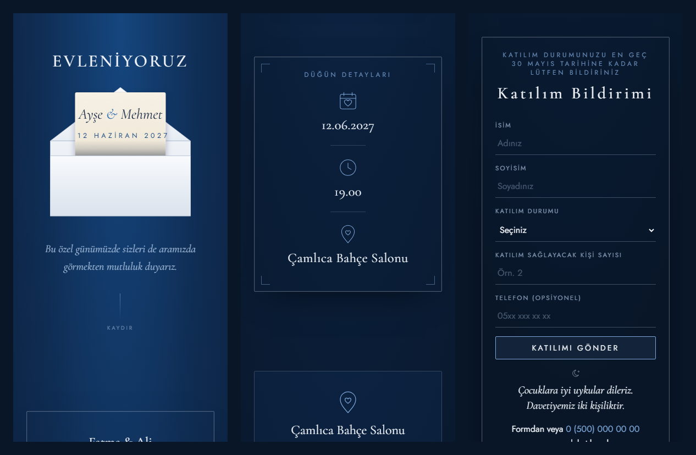
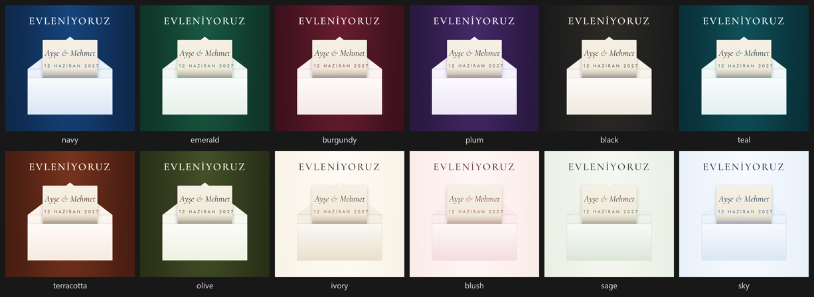

# 💌 Düğün Davetiyesi · Wedding Invitation

**🇹🇷 Türkçe** · [🇬🇧 English](README.en.md)

Kaydırılabilir, mobil uyumlu, tek sayfalık bir düğün davetiyesi. Misafirleriniz katılım
durumlarını (LCV) form üzerinden bildirir, yanıtlar **kendi Google E-Tablonuza** düşer.

**Kod bilgisi gerekmez.** Bütün ayarlar tek bir dosyada: [`invitation.yaml`](invitation.yaml).
Bilgisayarınıza hiçbir şey kurmadan, tamamen tarayıcıdan kurulup **ücretsiz** yayınlanır.



**Bölümler:** zarf + isimler + tarih → aileler + geri sayım → program akışı →
tarih/saat/mekan + harita → katılım formu → fotoğraf paylaşım linki + teşekkür.
Türkçe ve İngilizce hazır gelir, **12 renk teması** (8 koyu, 4 açık zeminli) arasından seçim yapılabilir.

---

## 🚀 Kurulum (yaklaşık 10 dakika)

İhtiyacınız olan tek şey ücretsiz bir [GitHub](https://github.com/signup) hesabı.

### 1. Şablonu kopyalayın
Bu sayfanın üstündeki yeşil **Use this template → Create a new repository** düğmesine basın.
Bir isim verin (ör. `dugunumuz`), **Public** seçin ve **Create repository**'ye tıklayın.

### 2. Yayını açın
Yeni reponuzda **Settings → Pages** bölümüne gidin. **Source** kısmında **GitHub Actions**'ı seçin.

### 3. Bilgilerinizi yazın
Reponuzda `invitation.yaml` dosyasına tıklayın, sağ üstteki **✏️ (kalem)** simgesine basın.
İsimleri, tarihi, aileleri, mekanı ve linkleri değiştirin. Ardından **Commit changes…** düğmesine basın.

> 💡 Sadece `:` işaretinden **sonraki** kısmı değiştirin. Soldaki adlara ve satır başındaki
> boşluklara dokunmayın. Dosyadaki her alanın üstünde açıklaması yazar.

### 4. Davetiyeniz yayında 🎉
**Actions** sekmesinde işlem 1-2 dakika içinde yeşil ✅ olur. Davetiyenizin linki:

```
https://<github-kullanıcı-adınız>.github.io/<repo-adı>/
```

(Link **Settings → Pages** sayfasında da yazar.) Bundan sonra `invitation.yaml`'da yaptığınız her
değişiklik birkaç dakika içinde otomatik olarak yayına yansır.

> İlk çalıştırma 2. adımdan önce başladıysa kırmızı ❌ görünebilir. **Actions** → son çalıştırma
> → **Re-run all jobs** ile tekrar çalıştırmanız yeterli.

---

## 📝 Katılım formu (Google E-Tablolar)

Formun yanıtları kaydedebilmesi için bir kerelik bu kurulumu yapın. `rsvp.scriptUrl` boş kaldığı
sürece form **deneme modunda** çalışır: misafire "Teşekkürler" ekranı görünür ama yanıt **kaydedilmez**.

1. [sheets.new](https://sheets.new) ile yeni bir Google E-Tablo oluşturun (ör. "Düğün LCV").
2. Menüden **Uzantılar → Apps Script**'i açın.
3. Açılan editördeki her şeyi silin. Bu repodaki [`apps-script/Code.gs`](apps-script/Code.gs)
   dosyasının içeriğini kopyalayıp yapıştırın. 💾 **Kaydet**'e basın.
4. Sağ üstten **Dağıt → Yeni dağıtım**'a tıklayın. ⚙️ simgesinden **Web uygulaması**'nı seçin, sonra:
   - **Şu kullanıcı olarak çalıştır:** *Ben*
   - **Erişimi olanlar:** *Herkes*

   ve **Dağıt**'a basın.
5. Google izin isterse hesabınızı seçin. *"Google bu uygulamayı doğrulamadı"* uyarısı çıkarsa
   **Gelişmiş → (proje adı)'na git (güvenli değil)** yolunu izleyip **İzin ver**'e tıklayın.
   Bu script'i siz oluşturduğunuz için bu uyarı normaldir. Script yalnızca bu tabloya satır ekler.
6. Size verilen **Web uygulaması URL'sini** (`https://script.google.com/macros/s/…/exec`) kopyalayın.
   `invitation.yaml` içinde `rsvp` altındaki `scriptUrl` satırına yapıştırın:
   ```yaml
   rsvp:
     scriptUrl: "https://script.google.com/macros/s/AKfy.../exec"
   ```
7. Davetiyeden bir deneme yanıtı gönderin. Tabloda başlıklarla birlikte yeni bir satır görmelisiniz.

Tablonun sütunları: *Zaman Damgası · İsim · Soyisim · Katılım Durumu · Kişi Sayısı · Telefon*.
"Kişi Sayısı" sütunu sayı olarak yazılır, toplam misafir sayısını `=TOPLA(E:E)` ile görebilirsiniz.

> Script'i sonradan değiştirirseniz **Dağıt → Dağıtımları yönet → ✏️ → Sürüm: Yeni sürüm**
> ile güncelleyin. Böylece link değişmez.

---

## ⚙️ `invitation.yaml` alanları

| Alan | Açıklama | Örnek |
|---|---|---|
| `language` | Sayfa dili: `tr` veya `en` | `tr` |
| `theme` | Renk teması: 12 seçenekten biri ([aşağıya bakın](#-renk-teması)) | `emerald` |
| `couple.name1`, `couple.name2` | Çiftin isimleri | `Ayşe`, `Mehmet` |
| `date` | Düğün tarihi, **YIL-AY-GÜN** | `2027-06-12` |
| `time` | Düğün saati, **tırnak içinde** | `"19:00"` |
| `families` | 0, 1 veya 2 aile (`names` + `surname`). Gizlemek için `families: []` | `Fatma & Ali` / `Yılmaz` |
| `program` | Akış: `title`, `time`, `icon` (`cocktail`, `rings`, `plate`, `music`). Gizlemek için `program: []` | `Nikah`, `"20:00"`, `rings` |
| `venue.name` | Mekan adı | `Çamlıca Bahçe Salonu` |
| `venue.address` | Açık adres (opsiyonel) | |
| `venue.mapsUrl` | Google Haritalar linki: **Paylaş → Bağlantıyı kopyala** (opsiyonel) | `https://maps.app.goo.gl/…` |
| `venue.mapImage` | Harita görseli (opsiyonel). Dosyayı `assets` klasörüne yükleyip adını yazın | `harita.jpg` |
| `rsvp.scriptUrl` | Katılım formu linki ([kurulum](#-katılım-formu-google-e-tablolar)) | `https://script.google.com/…/exec` |
| `rsvp.deadline` | Son bildirim tarihi (opsiyonel) | `2027-05-30` |
| `rsvp.phone` | Telefonla bildirim numarası (opsiyonel) | `"0 (555) 123 45 67"` |
| `rsvp.note` | Formun altındaki not (opsiyonel) | `"Davetiyemiz iki kişiliktir."` |
| `photos.url` | Misafirlerin fotoğraf yükleyeceği link, ör. Google Drive klasörü (opsiyonel; boşsa bölüm gizlenir) | `https://drive.google.com/…` |
| `texts` | **İleri seviye:** hazır metinleri değiştirmek için. Tüm anahtarlar [`src/i18n.js`](src/i18n.js) dosyasında | `heroTitle: BİZ EVLENİYORUZ` |

**Opsiyonel** alanları kullanmak istemiyorsanız değerlerini `""` yapın; ilgili kısım sayfadan kalkar.

### 🎨 Renk teması
`invitation.yaml` içindeki `theme:` satırına aşağıdakilerden birini yazın. Bütün sayfa (zemin, zarf,
ikonlar, çerçeveler, butonlar) seçtiğiniz renge göre değişir.

| Koyu zemin | Renk | Açık zemin | Renk |
|---|---|---|---|
| `navy` | Gece mavisi (varsayılan) | `ivory` | Fildişi & altın |
| `emerald` | Zümrüt yeşili & altın | `blush` | Pudra pembesi & gül |
| `burgundy` | Bordo & gül altını | `sage` | Adaçayı yeşili |
| `plum` | Mürdüm & lavanta | `sky` | Buz mavisi |
| `black` | Siyah & altın | | |
| `teal` | Petrol mavisi & bakır | | |
| `terracotta` | Kiremit & krem | | |
| `olive` | Zeytin yeşili & keten | | |



### 🖼️ Görsel eklemek (harita)
Reponuzda `assets` klasörüne girin, **Add file → Upload files** ile görseli yükleyin
(ör. `harita.jpg`) ve `invitation.yaml`'a `mapImage: harita.jpg` yazın.

---

## ❓ Sık karşılaşılan sorunlar

**Actions sekmesinde kırmızı ❌ var.** Kırmızı çalıştırmaya, ardından **build → Build (reads invitation.yaml)**
adımına tıklayın. Hata mesajı Türkçe ve İngilizce olarak neyin, hangi satırda düzeltilmesi gerektiğini yazar. Örnek:
```
✖ invitation.yaml dosyasında 1 sorun var:
• date YIL-AY-GÜN biçiminde olmalı, ör. 2027-06-12 (yazılan: "12.06.2027").
```

**"syntax error on line …" hatası.** Belirtilen satırda girinti (satır başı boşluğu) kaymıştır ya da
`:` işaretinden sonra boşluk unutulmuştur. Alt alanlar (ör. `name1`) her zaman **2 boşluk** içeride olmalıdır.

**Saat yanlış görünüyor ya da hata veriyor.** Saati tırnak içinde yazın: `time: "19:00"`.

**Form "Teşekkürler" diyor ama tabloya bir şey gelmiyor.** `rsvp.scriptUrl` boş olabilir ya da
Apps Script dağıtımında *Erişimi olanlar: Herkes* seçilmemiş olabilir.

**Kendi alan adımı (domain) kullanmak istiyorum.** **Settings → Pages → Custom domain** kısmına alan
adınızı girin. Ardından **Settings → Secrets and variables → Actions → Variables** bölümünde
`CUSTOM_DOMAIN` adında, değeri `true` olan bir değişken ekleyin.

---

## 🧑‍💻 Geliştiriciler için

```bash
npm install
npm run dev       # http://localhost:5173 — invitation.yaml değişince sayfa yenilenir
npm run build     # dist/ klasörünü üretir (statik site)
npm run preview   # build çıktısını yerelde açar
```

- **Teknolojiler:** React + Vite + Tailwind CSS. Sunucu yok; çıktı tamamen statik bir sitedir.
- `scripts/invitation-plugin.js`: `invitation.yaml`'ı okur, doğrular ve `virtual:invitation`
  modülü olarak uygulamaya verir. `<title>`, `<html lang>` ve açıklama etiketlerini de doldurur.
- `src/config.js`: ayarlardan türetilen değerler (tarih biçimleri, geri sayım hedefi) ve `t()` metin fonksiyonu.
- `src/i18n.js`: tüm hazır metinler (TR/EN). Yeni dil eklemek için buraya bir sözlük ve
  `locales` içine bir satır ekleyin, ardından `scripts/invitation-plugin.js` içindeki `LANGUAGES` listesini güncelleyin.
- `src/themes.css`: renk temaları. Yeni tema için bir blok kopyalayıp renkleri değiştirin ve adını
  `scripts/invitation-plugin.js` içindeki `THEMES` listesine ekleyin.
- `apps-script/Code.gs`: LCV yanıtlarını Google E-Tablo'ya yazan Apps Script.
- **Netlify / Vercel / Cloudflare Pages:** repoyu içe aktarın. Build komutu `npm run build`,
  çıktı klasörü `dist`. Ek ayar gerekmez.

## Lisans

[MIT](LICENSE). Dilediğiniz gibi kullanın, değiştirin, paylaşın. Mutluluklar! 💍
